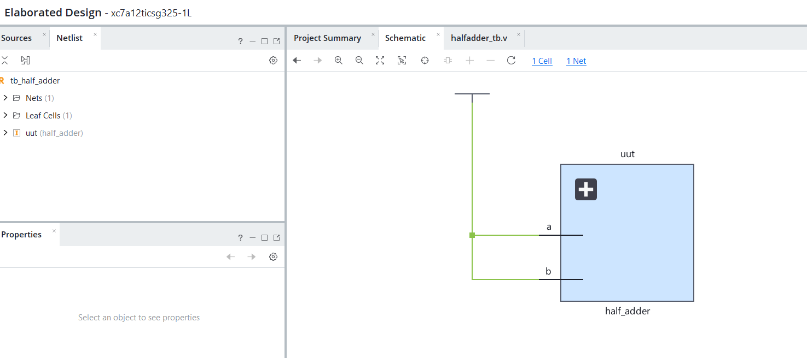
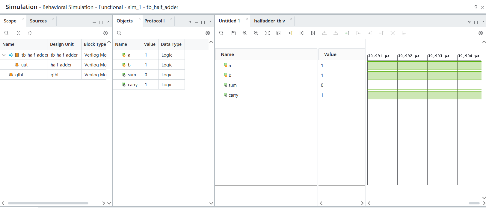
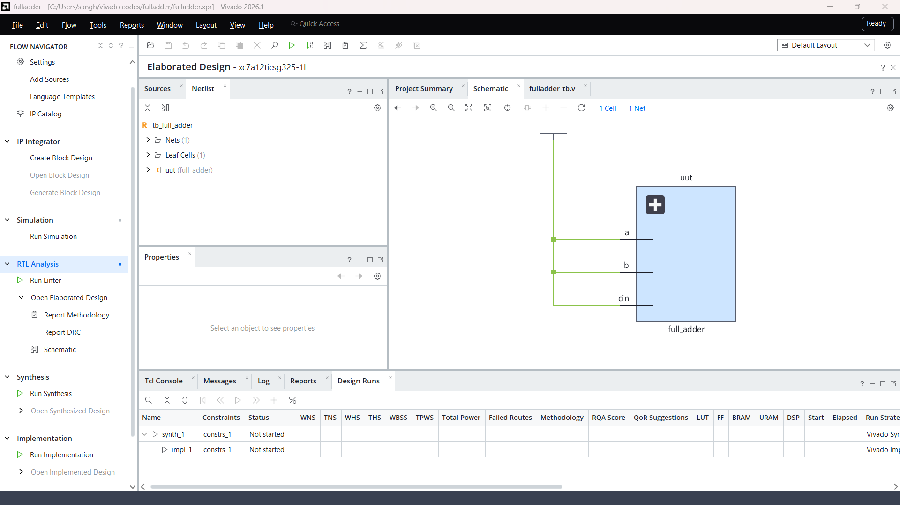
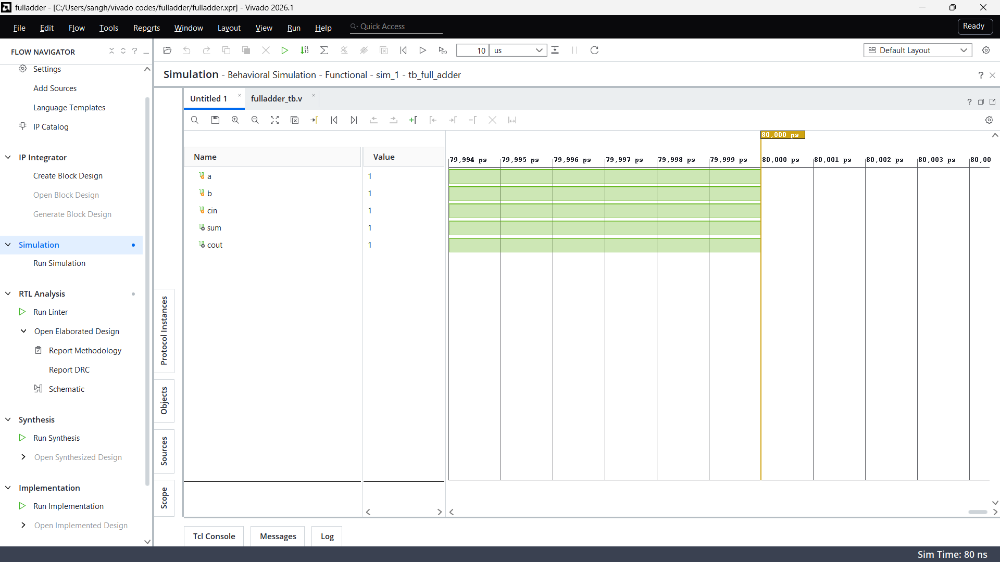

# Half Adder and Full Adder in Verilog

Project 2 in my Verilog/FPGA project series. Each adder is written in two modeling styles (gate-level and dataflow), and a self-checking testbench verifies both against the expected result.

## Contents

| File | Description |
|------|-------------|
| `src/half_adder.v` | `half_adder_gate` (gate primitives) and `half_adder_df` (assign statements) |
| `src/full_adder.v` | `full_adder_gate` (built from two half adders and an OR gate) and `full_adder_df` (assign statements) |
| `tb/tb_adders.v` | Self-checking testbench covering every input combination |
| `docs/` | Waveform and schematic screenshots |

## Truth tables

**Half adder**

| a | b | sum | carry |
|---|---|-----|-------|
| 0 | 0 | 0 | 0 |
| 0 | 1 | 1 | 0 |
| 1 | 0 | 1 | 0 |
| 1 | 1 | 0 | 1 |

**Full adder**

| a | b | cin | sum | cout |
|---|---|-----|-----|------|
| 0 | 0 | 0 | 0 | 0 |
| 0 | 0 | 1 | 1 | 0 |
| 0 | 1 | 0 | 1 | 0 |
| 0 | 1 | 1 | 0 | 1 |
| 1 | 0 | 0 | 1 | 0 |
| 1 | 0 | 1 | 0 | 1 |
| 1 | 1 | 0 | 0 | 1 |
| 1 | 1 | 1 | 1 | 1 |

## Design notes

- Half adder: `sum = a XOR b`, `carry = a AND b`.
- Full adder: `sum = a XOR b XOR cin`, `cout = ab + b.cin + a.cin`.
- The gate-level full adder reuses the half adder: two half adders plus one OR gate for the final carry.
- The testbench computes the expected result with the `+` operator and compares it with both versions, so a mismatch prints an error and the run ends with PASS or FAIL.

## How to simulate in Vivado

1. Create an RTL project and add `src/half_adder.v` and `src/full_adder.v` as design sources.
2. Add `tb/tb_adders.v` as a simulation source and set it as the top module.
3. Click **Run Simulation → Run Behavioral Simulation**.
4. Read the truth tables and the PASS line in the Tcl Console, and inspect the signals in the waveform window.

## Expected console output

```
---- Half Adder ----
 a b | sum carry
 0 0 |  0    0
 0 1 |  1    0
 1 0 |  1    0
 1 1 |  0    1

---- Full Adder ----
 a b cin | sum cout
 0 0  0  |  0    0
 0 0  1  |  1    0
 0 1  0  |  1    0
 0 1  1  |  0    1
 1 0  0  |  1    0
 1 0  1  |  0    1
 1 1  0  |  0    1
 1 1  1  |  1    1

PASS: all half adder and full adder tests passed.
```

## Half Adder
- **Synthesis Schematic:** 
- **Waveform:** 

## Full Adder
- **Synthesis Schematic:** 
- **Waveform:** 

## Tools

- AMD Vivado 2026.1 (behavioral simulation)
